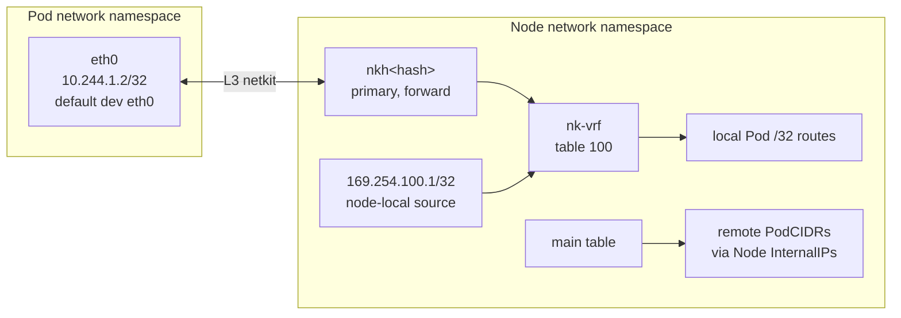
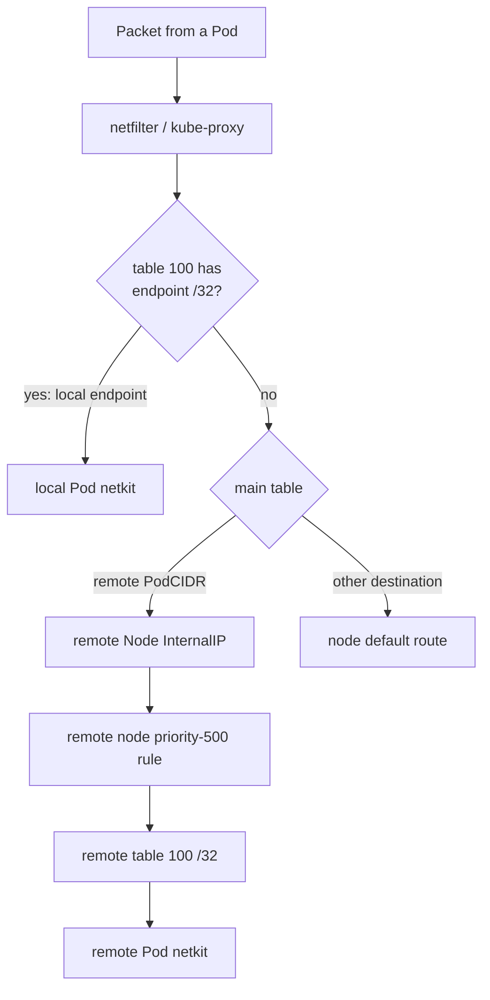

# netkit-cni

[](https://github.com/srodi/netkit-cni/actions/workflows/ci.yml)

`netkit-cni` is an educational Kubernetes CNI that connects Pods with Linux
**L3 netkit** devices and keeps local Pod routes in a Linux **VRF**. It uses
ordinary Linux routing between nodes and works with kube-proxy Services.

The project favors readable code and inspectable state over production
features. It supports IPv4 only.

## What it builds

Each Pod gets an L3 netkit pair:



The host primary is attached to `nk-vrf`. Table 100 contains one `/32` route
for each local Pod. The main table contains one route for each remote node's
PodCIDR. Every node assigns `169.254.100.1/32` to its VRF so host-originated
connections, including kubelet probes, have a valid source address. The
address is node-local and is never routed between nodes.

There is no bridge, overlay, per-Pod veth, synthetic gateway, or project-owned
NAT. Both ends of every netkit pair use the kernel's `forward` policy; this
project attaches no BPF program.

## Route selection

The agent installs this policy:

```text
priority 500:  to <local PodCIDR> lookup 100
priority 1000: lookup [l3mdev-table]
priority 32766: lookup main
```

Table 100 intentionally has no default route. If it has no matching local Pod
route, policy evaluation continues to `main`.



This gives the important paths:

- **same-node Pod:** table 100 routes directly between Pod netkit devices;
- **cross-node Pod:** table 100 misses, then `main` routes via the remote node;
- **incoming Pod traffic:** the destination rule selects table 100 and its
  local `/32`;
- **ClusterIP:** kube-proxy translates the Service address before routing;
  the selected endpoint then follows the same local or remote path;
- **external destination:** table 100 misses and the node's main default route
  applies.

The VRF organizes local Pod routes; it is not a security boundary. Network
policy and egress masquerading are outside this project.

## Components

### `netkit-cni`

For CNI `ADD`, the plugin:

1. delegates address allocation to `host-local`;
2. creates an L3 netkit pair;
3. moves the peer into the existing Pod network namespace as `eth0`;
4. attaches the host primary to `nk-vrf`;
5. assigns the Pod a `/32` and `default dev eth0`;
6. adds the Pod `/32` to table 100; and
7. returns the CNI result.

It also implements idempotent `DEL` and validates the resulting state in
`CHECK`. Failures after allocation roll back the link and IPAM allocation.

### `netkit-agent`

The privileged, host-networked DaemonSet:

- reads Node PodCIDRs and InternalIPs;
- creates `nk-vrf` with table 100;
- assigns its node-local host source address;
- installs remote PodCIDR routes in `main`;
- installs the local-PodCIDR rule for table 100;
- enables forwarding, disables reverse-path filtering, and enables the TCP
  and UDP l3mdev socket settings needed by host services;
- writes the node-specific CNI configuration atomically; and
- removes obsolete routes and transit links from earlier project versions.

Route protocols separate ownership:

- protocol 98: remote PodCIDR routes owned by the agent;
- protocol 99: local Pod `/32` routes owned by the CNI.

## Prerequisites

- native Linux or a Linux VM;
- kernel 6.8+ with `CONFIG_NETKIT`, `CONFIG_NET_L3_MASTER_DEV`, and
  `CONFIG_NET_VRF`;
- Docker, kind, kubectl, Go 1.26+, and iproute2;
- root privileges for the focused network-namespace integration test.

The kind node image shares the Docker host kernel. A newer node image cannot
provide a missing netkit or VRF driver.

On Ubuntu:

```sh
sudo ./scripts/install-prerequisites-ubuntu.sh
make prerequisites
```

`make prerequisites` checks configuration when available and performs the
authoritative test by creating temporary netkit and VRF devices.

## Build and test

Fast checks:

```sh
make check
make build
```

Focused Linux integration:

```sh
sudo make integration
```

Three-node kind test:

```sh
make kind-up
make e2e
make kind-down
```

The E2E test verifies:

- same-node and cross-node Pod traffic in both directions;
- preservation of the source Pod IP;
- local-endpoint and remote-endpoint ClusterIP Services;
- cluster DNS and a headless Service;
- L3 netkit type, forward policy, and VRF membership;
- remote PodCIDR routes, local Pod `/32` routes, and policy rules;
- absence of obsolete transit links and routes; and
- the VRF host source address, forwarding, and l3mdev sysctls.

Run `make diagnose` to collect Pods, logs, links, routes, rules, sysctls, and
route lookups when a test fails.

## Run on an existing cluster

Pushing a `v*` tag publishes `ghcr.io/srodi/netkit-cni:<version>` (linux/amd64
only) through the `Image` workflow. The manifest uses a local
`netkit-cni:dev` image, so override the image and pull policy when applying it:

```sh
VERSION=0.1.0
sed -e "s|image: netkit-cni:dev|image: ghcr.io/srodi/netkit-cni:${VERSION}|" \
    -e "s|imagePullPolicy: Never|imagePullPolicy: IfNotPresent|" \
    deploy/netkit-cni.yaml | kubectl apply -f -
```

The cluster must meet the [prerequisites](#prerequisites): Nodes with kernel
6.8+ and netkit and VRF support, allocated PodCIDRs, and no other CNI.
Cross-node traffic works only where the underlay routes Pod CIDRs between
Node InternalIPs, as described under Troubleshooting. This path has been
tested only with kind.

## Inspect a node

```sh
NODE=netkit-cni-worker

docker exec "$NODE" ip -details link show type netkit
docker exec "$NODE" ip -details link show nk-vrf
docker exec "$NODE" ip -4 rule show
docker exec "$NODE" ip -4 route show table 100
docker exec "$NODE" ip -4 route show table main proto 98
docker exec "$NODE" cat /etc/cni/net.d/10-netkit-cni.conf
```

Expected route ownership resembles:

```text
# table 100: local Pods
10.244.1.2 dev nkh... proto 99 scope link
10.244.1.3 dev nkh... proto 99 scope link

# main: remote nodes
10.244.0.0/24 via 172.18.0.4 dev eth0 proto 98
10.244.2.0/24 via 172.18.0.2 dev eth0 proto 98
```

`iproute2` may display protocol 99 as `openr` because that number is assigned a
name in `/etc/iproute2/rt_protos`.

## Troubleshooting

### Netkit creation reports `operation not supported`

The running host kernel lacks netkit support. Run `make prerequisites`; kernel
version alone is not proof that the driver is configured and loadable.

### Nodes stay `NotReady`

```sh
kubectl -n kube-system get pods -l app.kubernetes.io/name=netkit-cni -o wide
kubectl -n kube-system logs daemonset/netkit-agent -c agent
```

Check kernel support, Node PodCIDRs, and whether `nk-vrf` is occupied by an
incompatible link.

### Cross-node traffic fails

Verify that:

- Node InternalIPs are mutually reachable;
- `main` contains protocol-98 routes for remote PodCIDRs;
- forwarding is enabled and reverse-path filtering is disabled; and
- the underlay firewall permits Pod-source traffic.

The project does not distribute routes outside Kubernetes nodes. Real
networks may need BGP, cloud routes, static routes, or an overlay.

### Host services cannot reach Pods

Linux scopes sockets by VRF. The agent enables `tcp_l3mdev_accept` and
`udp_l3mdev_accept` for kubelet probes and other unbound host services. Linux
documents ambiguous listener selection if an unbound service and a VRF-bound
service use the same port.

## Performance scope

The project retains netkit's L3, `NOARP`, `NO_QUEUE`, host-managed peer, and
BPF-ready device model. Removing the former node transit pair also removes an
extra device crossing and receive-side reinjection.

It does not reproduce Cilium's optimized datapath. Packets still use ordinary
Linux FIB lookups, policy rules, netfilter, conntrack, and kube-proxy. Compare
equivalent topologies on the same kernel and hardware before attributing a
benchmark result to netkit alone.

## Limitations and security

Do not use this educational project in a production or sensitive cluster. It
has:

- no NetworkPolicy, workload firewall, encryption, or observability;
- no IPv6, dual stack, MTU discovery, or underlay capability detection;
- no Service implementation of its own; it relies on kube-proxy;
- no distributed IPAM or route-distribution protocol;
- no comprehensive crash recovery, upgrade framework, or orphaned-IP cleanup;
- a privileged agent that can modify host networking and CNI files; and
- unencapsulated Pod traffic that the underlay must route and permit.

## References

- [CNI specification](https://www.cni.dev/docs/spec/)
- [Linux netkit source](https://git.kernel.org/pub/scm/linux/kernel/git/torvalds/linux.git/tree/drivers/net/netkit.c)
- [Linux VRF documentation](https://docs.kernel.org/networking/vrf.html)
- [Kubernetes virtual IPs and Service proxies](https://kubernetes.io/docs/reference/networking/virtual-ips/)
- [Cilium netkit tuning](https://docs.cilium.io/en/stable/operations/performance/tuning/#netkit-device-mode)
- [Calico routed datapath](https://docs.tigera.io/calico/latest/reference/architecture/data-path)
